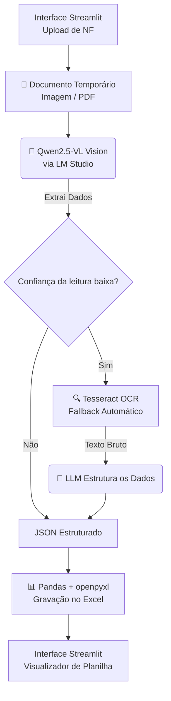

# 🧾 AI Fiscal Assistant

> Assistente financeiro com IA que realiza a leitura automática de notas fiscais e organiza todas as informações em planilhas Excel avançadas. 

O projeto é desenvolvido em etapas progressivas, cada uma construindo sobre a anterior, com o objetivo de demonstrar a aplicação prática de técnicas avançadas de Engenharia de IA e Automação de Dados em um problema corporativo real.

## 🚀 Etapas do Projeto

| # | Etapa | Status | Descrição |
|---|---|:---:|---|
| 1 | `step1_ocr/` | ✅ Concluída | Extração de dados via OCR (PyTesseract + OpenCV) |
| 2 | `step2_llm/` | ✅ Concluída | Processamento Vision com LLM local (Qwen2.5-VL) |
| 3 | `step3_spreadsheet/` | ✅ Concluída | Gravação acumulativa e inteligente em planilha Excel |
| 4 | `step4_interface/` | ✅ Concluída | Interface visual interativa de upload, visualização e chat |
| 5 | `step5_dashboard/` | 🚧 Em andamento | Dashboard financeiro, analytics e integração com Google Sheets |


---

## 🏗️ Arquitetura Atual (Pipeline de Processamento)

O sistema opera como um pipeline completo de ETL (Extract, Transform, Load), agora orquestrado por uma interface visual centralizada.



## 🛠️ Stack Tecnológico

| Camada | Tecnologia Utilizada |
|---|---|
| **Interface & UI** | `streamlit` |
| **OCR (Fallback)** | `pdfplumber`, `pytesseract`, `opencv-python` |
| **Vision + LLM** | Qwen2.5-VL-3B-Instruct (via LM Studio local) |
| **Manipulação de Dados** | `pandas`, `openpyxl` |
| **Linguagem** | Python 3.10+ |

---

## ⚙️ Como Rodar Localmente

**Pré-requisitos:**
- Python 3.10+
- Git
- LM Studio instalado com o modelo `Qwen2.5-VL-3B-Instruct`.

### 🚀 Método 1: Execução Automática (Apenas Windows)
Para a melhor experiência de desenvolvedor (DX), criamos um script automatizado que gerencia o ambiente virtual, instala dependências e inicia os servidores.

1. Abra o LM Studio.
2. Dê um duplo clique no arquivo `iniciar.bat`.
3. O script irá iniciar o servidor local do LM Studio, configurar o Python e abrir a interface no seu navegador automaticamente.

### 💻 Método 2: Execução Manual (Mac / Linux / Windows)

**Passo 1: Preparar o projeto**
```bash
git clone https://github.com/leandrobelo000-afk/ai-fiscal-assistant.git
cd ai-fiscal-assistant
```

**Passo 2: Criar e ativar o ambiente virtual**
```bash
python -m venv .venv

# Windows:
.venv\Scriptsctivate
# Mac/Linux:
source .venv/bin/activate
```

**Passo 3: Instalar as dependências**
```bash
pip install -r requirements.txt
```

**Passo 4: Iniciar o Servidor LLM e a Interface**
1. No **LM Studio**, inicie o servidor local na porta `1234`.
2. No seu terminal, rode o comando:
```bash
streamlit run step5_dashboard/app.py
```

**Erro `did not find executable at ...python.exe`?** O `.venv` foi criado com um Python que não existe mais (por exemplo, depois de atualizar o Python). Apague a pasta e crie de novo:
```bash
# Windows (PowerShell):
Remove-Item -Recurse -Force .venv
python -m venv .venv
.venv\Scripts\activate
pip install -r requirements.txt
```
O `iniciar.bat` já faz isso sozinho.

---

## 🔍 Detalhamento das Etapas Recentes

### 🖥️ Etapa 4 — Interface Visual (Streamlit)
O arquivo `app.py` orquestra todas as etapas anteriores em uma interface de usuário amigável.
- **Gerenciamento de Arquivos:** Utiliza `tempfile` para processar PDFs e imagens de forma segura, sem sobrecarregar o disco local.
- **Integração de Módulos:** Chama as funções de OCR, Vision e gravação em planilha de forma sequencial.
- **Visualizador Integrado:** Lê diretamente o arquivo Excel gerado (Aba Resumo e Itens) e exibe os dados processados na própria tela usando `pandas`.
- **Chat Contextual (Em desenvolvimento):** Preparação de UI para permitir perguntas e respostas baseadas nos dados da nota fiscal recém processada.

### 🗄️ Etapa 5.0 — Fundação de Dados (SQLite)
Antes do dashboard, os dados passam a viver em uma base SQLite (`notas_fiscais.db`), que vira a fonte única. O Excel continua sendo gerado e, nas próximas fases, o Google Sheets também.
- **Chave única:** uma nota é identificada por CNPJ do emitente + número, então fornecedores diferentes com o mesmo número não são descartados.
- **Tipos corretos:** datas em ISO (`AAAA-MM-DD`), CNPJ só com dígitos e valores como número, prontos para agrupar por mês e fornecedor.
- **Migração:** `python step5_dashboard/database.py notas_fiscais.xlsx` importa uma planilha antiga, ignorando as linhas "TOTAL GERAL".
- **Testes:** `pytest` roda os testes da base e da planilha.

### 📊 Etapa 5.1 — Dashboard Financeiro (Streamlit + Plotly)
Um único app junta a tela de processamento da Etapa 4 e o dashboard, lendo direto da base SQLite:
```bash
streamlit run step5_dashboard/app.py
```
- **Visão Geral:** gasto total (com variação contra o mês anterior), nº de notas, ticket médio, impostos e carga tributária; gasto por mês e maiores fornecedores.
- **Fornecedores:** curva ABC (A = até 80% do gasto, B = até 95%, C = o restante) com gráfico e tabela.
- **Itens:** itens com maior gasto e busca por descrição.
- **Filtros** de período e fornecedor na barra lateral, e **exportação para Excel** do recorte atual, gerada a partir da base.
- Os cálculos ficam em `analytics.py`, separados da interface e cobertos por testes.

### ☁️ Etapa 5.2 — Google Sheets + Looker Studio
A base SQLite é espelhada em uma planilha do Google Sheets (abas **Notas**, **Itens** e **Resumo Mensal**), que serve de fonte para um painel no Looker Studio. A sincronização é de mão única e reescreve as abas inteiras, então nunca duplica linhas.

**Configuração (uma vez, pela tela):** abra o app e vá em **Configurações > Google Sheets**. A página guia em três passos:
1. **Chave de acesso:** os botões levam direto ao Google Cloud para criar uma **conta de serviço**, baixar a chave **JSON** e ativar a **Google Sheets API**. Depois é só arrastar o arquivo para a página (ele fica em `credenciais/`, que está no `.gitignore`).
2. **Planilha:** crie uma planilha (botão **Criar planilha nova**), compartilhe com o e-mail da conta de serviço mostrado na tela como **Editor** e cole o link da planilha. O app testa a conexão na hora e, se algo faltar (API desligada, planilha não compartilhada, link errado), diz exatamente o que fazer.
3. **Sincronizar:** envia as notas e abre a planilha.

Quem já tinha configurado pelo `.env` (`GOOGLE_SHEET_ID` e `GOOGLE_CREDENTIALS`) não precisa mudar nada; o que for salvo pela tela passa a valer no lugar.

**Uso:** depois de configurado, cada nota processada atualiza a planilha automaticamente. Também dá para sincronizar pelo botão **Sincronizar com Google Sheets** na Visão Geral, ou pelo terminal:
```bash
python step5_dashboard/sheets_sync.py
```

**Painel no Looker Studio:**
1. Em [lookerstudio.google.com](https://lookerstudio.google.com/), crie um relatório e adicione a fonte **Planilhas Google**, escolhendo a aba **Notas** (marque "Usar a primeira linha como cabeçalho").
2. Confira os tipos dos campos: `data_emissao` como **Data**, `valor_total` e `impostos` como **Moeda (BRL)**.
3. Sugestão de páginas: indicadores (soma de `valor_total`, contagem de notas, soma de `impostos`), série temporal por `data_emissao` (mês), barras por `fornecedor` e um controle de período.
4. Adicione a aba **Itens** como segunda fonte para a página de itens.
5. Em **Compartilhar**, gere um link de visualização para o portfólio.

**Próxima fase:** 5.3 IA analítica (categorias, anomalias, chat com a base).
