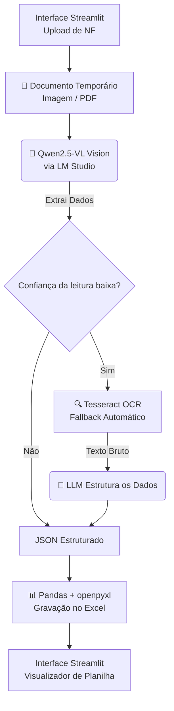

# 🧾 AI Fiscal Assistant

> Assistente financeiro com IA que realiza a leitura automática de notas fiscais e organiza todas as informações em planilhas Excel avançadas. 

O projeto é desenvolvido em etapas progressivas, cada uma construindo sobre a anterior, com o objetivo de demonstrar a aplicação prática de técnicas avançadas de Engenharia de IA e Automação de Dados em um problema corporativo real.

## 🚀 Etapas do Projeto

| # | Etapa | Status | Descrição |
|---|---|:---:|---|
| 1 | `step1_ocr/` | ✅ Concluída | Extração de dados via OCR (PyTesseract + OpenCV) |
| 2 | `step2_llm/` | ✅ Concluída | Processamento Vision com LLM local (Qwen2.5-VL) |
| 3 | `step3_spreadsheet/` | ✅ Concluída | Gravação acumulativa e inteligente em planilha Excel |
| 4 | `step4_interface/` | ✅ Concluída | Interface visual interativa de upload, visualização e chat |
| 5 | `step5_dashboard/` | 🔜 Em breve | Dashboard financeiro e analytics |

---

## 🏗️ Arquitetura Atual (Pipeline de Processamento)

O sistema opera como um pipeline completo de ETL (Extract, Transform, Load), agora orquestrado por uma interface visual centralizada.



## 🛠️ Stack Tecnológico

| Camada | Tecnologia Utilizada |
|---|---|
| **Interface & UI** | `streamlit` |
| **OCR (Fallback)** | `pdfplumber`, `pytesseract`, `opencv-python` |
| **Vision + LLM** | Qwen2.5-VL-3B-Instruct (via LM Studio local) |
| **Manipulação de Dados** | `pandas`, `openpyxl` |
| **Linguagem** | Python 3.11+ |

---

## ⚙️ Como Rodar Localmente

**Pré-requisitos:**
- Python 3.11+
- Git
- LM Studio instalado com o modelo `Qwen2.5-VL-3B-Instruct`.

### 🚀 Método 1: Execução Automática (Apenas Windows)
Para a melhor experiência de desenvolvedor (DX), criamos um script automatizado que gerencia o ambiente virtual, instala dependências e inicia os servidores.

1. Abra o LM Studio.
2. Dê um duplo clique no arquivo `iniciar.bat`.
3. O script irá iniciar o servidor local do LM Studio, configurar o Python e abrir a interface no seu navegador automaticamente.

### 💻 Método 2: Execução Manual (Mac / Linux / Windows)

**Passo 1: Preparar o projeto**
```bash
git clone https://github.com/leandrobelo000-afk/ai-fiscal-assistant.git
cd ai-fiscal-assistant
```

**Passo 2: Criar e ativar o ambiente virtual**
```bash
python -m venv .venv

# Windows:
.venv\Scriptsctivate
# Mac/Linux:
source .venv/bin/activate
```

**Passo 3: Instalar as dependências**
```bash
pip install -r requirements.txt
```

**Passo 4: Iniciar o Servidor LLM e a Interface**
1. No **LM Studio**, inicie o servidor local na porta `1234`.
2. No seu terminal, rode o comando:
```bash
streamlit run step4_interface/app.py
```

---

## 🔍 Detalhamento das Etapas Recentes

### 🖥️ Etapa 4 — Interface Visual (Streamlit)
O arquivo `app.py` orquestra todas as etapas anteriores em uma interface de usuário amigável.
- **Gerenciamento de Arquivos:** Utiliza `tempfile` para processar PDFs e imagens de forma segura, sem sobrecarregar o disco local.
- **Integração de Módulos:** Chama as funções de OCR, Vision e gravação em planilha de forma sequencial.
- **Visualizador Integrado:** Lê diretamente o arquivo Excel gerado (Aba Resumo e Itens) e exibe os dados processados na própria tela usando `pandas`.
- **Chat Contextual (Em desenvolvimento):** Preparação de UI para permitir perguntas e respostas baseadas nos dados da nota fiscal recém processada.
